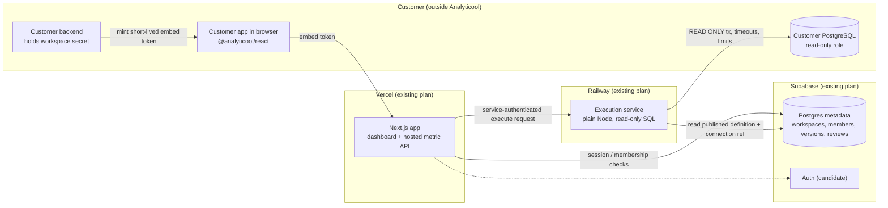

# Backend stack and basic deployment topology

Status: **Proposed** — BRU-464, 2026-11-14. Decision owner: repository owner. Unblocks [BRU-492](https://linear.app/brunosimplicio/issue/BRU-492/persist-approved-metrics-and-build-a-reusable-metrics-library) (persistent metric metadata and workspace authorization), [BRU-493](https://linear.app/brunosimplicio/issue/BRU-493/build-mvp-read-only-postgresql-source-connector-and-metric-execution) (isolated read-only PostgreSQL execution) and [BRU-494](https://linear.app/brunosimplicio/issue/BRU-494/define-hosted-metric-api-and-secure-embed-token-authorization-contract) (hosted token boundary).

This ADR records the smallest backend stack those three issues need, using the existing Vercel, Supabase and Railway plans. It is a design record only: **this spike changes no code, dependencies, environment variables, deploy configuration or cloud services**, following the 2026-11-03 decision ("No infrastructure changes at bootstrap") and [CONTRIBUTING.md](../../CONTRIBUTING.md). Everything in §§2–4 is a proposed design; nothing here is implemented or deployed.

## 1. Current baseline (audited)

Verified from this repository at the BRU-464 branch point (`50d60bb`):

| Fact                                                                                                                     | Evidence                                                                                                                      |
| ------------------------------------------------------------------------------------------------------------------------ | ----------------------------------------------------------------------------------------------------------------------------- |
| TypeScript workspace on Node 24 (`24.21.0`), pnpm 10.34.9                                                                | [`.nvmrc`](../../.nvmrc), [`package.json`](../../package.json) `engines`, `packageManager`                                    |
| One Next.js 16.4.5 App Router demo; config only transpiles workspace packages                                            | [`apps/demo/package.json`](../../apps/demo/package.json), [`apps/demo/next.config.ts`](../../apps/demo/next.config.ts)        |
| Pure, IO-free domain contracts and calculations                                                                          | [`packages/core`](../../packages/core/src), [README architecture](../../README.md#architecture)                               |
| Stateless React components that accept results and never fetch                                                           | [`packages/react`](../../packages/react/src)                                                                                  |
| No route handlers, server API, database, ORM, environment variables, Dockerfile or `vercel.json`/Railway/Supabase config | Repository tree; [README "Run locally"](../../README.md#run-locally), [README boundaries](../../README.md#current-boundaries) |
| Approval and publication are process-local; they are not authorization                                                   | [README proposal lifecycle](../../README.md#proposal-trust-and-lifecycle), [metric provenance ADR](metric-provenance.md)      |
| Demo selects a fixed fictional workspace in app code; accepts no tenant IDs, SQL or database URLs from clients           | [SECURITY.md trust boundaries](../../SECURITY.md#trust-boundaries)                                                            |
| CI runs lint, format, typecheck, tests, net receipts replay, Python oracle and build; no deploy step                     | [`.github/workflows/ci.yml`](../../.github/workflows/ci.yml)                                                                  |

Not verified by this repository: anything about the contents, limits or regions of the existing Supabase, Railway and Vercel plans. See §5.

## 2. Decisions

Each decision states the choice, why, and what would make us revisit it.

**a. Language and runtime — TypeScript on Node 24.** Same toolchain as the existing workspace, so `@analyticool/core` contracts (Zod schemas, calculations) are reused directly on every server component. _Revisit:_ never as an incidental change.

**b. HTTP routing — keep Next.js; no Hono yet.** Do not add Hono or replace the demo. Dashboard pages and the first hosted metric endpoints for BRU-492/BRU-494 are Next.js server code (server actions or route handlers) on Vercel. The separate execution service (decision e) uses a plain `node:http` server with no framework. _Revisit Hono_ only when a versioned, public metrics API with its own release cadence is needed (2026-11-03 record).

**c. Developer SDK — keep `@analyticool/react` stateless.** The embeddable surface stays `<MetricKpi result />` / `<MetricChart result />`, which never fetch or hold credentials. BRU-494 adds, at most, a small server-side helper for the customer's backend to mint embed tokens and a thin fetch of a validated result; it must work in any Node server, not only Next.js. No package is published until package output and compatibility checks exist (README). _Revisit:_ when an external developer needs an npm release.

**d. Metadata store (BRU-492) — Postgres on the existing Supabase plan.** It holds only Analyticool's own records: workspaces, memberships, connection references, metric definitions, immutable published versions and review/approval records with reviewer identity and timestamps. **No customer analytical data is copied into it.** Workspace authorization is enforced in server code on every read and write, deriving the workspace from the authenticated session and membership rows, never from a client-supplied ID. Version uniqueness and immutability are enforced by database constraints, re-establishing the authority that today is process-local. Row Level Security may be added as **defense in depth only**; it is not the primary control while the auth provider is undecided (§6). Drizzle is **optional and scoped to this metadata schema** (typed tables and migrations); it is never a required abstraction over analytical SQL. _Revisit:_ if metadata volume or connection counts exceed the plan (§5).

**e. Query engine (BRU-493) — Postgres first, on the customer's own Postgres.** Execution reads the customer's PostgreSQL directly, with layered controls: a customer-created read-only role, `BEGIN READ ONLY` transactions, `statement_timeout` and `idle_in_transaction_session_timeout`, row and byte limits on results, and SQL **compiled only from approved, published definitions** with bound parameters. Clients never send SQL. Query engine choice is separate from HTTP routing: DuckDB or ClickHouse are considered only if benchmarks on realistic data show Postgres cannot meet latency or cost targets. _Revisit:_ with benchmark evidence from BRU-493.

**f. Execution isolation — a separate Railway service from BRU-493 onwards.** The executor runs as its own Railway service, apart from the Vercel web tier, so that customer connection secrets, decryption keys and long-lived pooled connections to customer databases never sit in serverless functions. It exposes a minimal internal API (execute published version _X_ for workspace _W_ with validated parameters) and authenticates every call from the web tier with a service credential. It does not accept SQL, connection strings or workspace IDs from browsers. Requests are synchronous and bounded by the timeouts above. _Revisit:_ merge back into the web tier only if isolation turns out unnecessary, which is unlikely.

**g. Worker and queue — none now.** Bounded synchronous execution covers BRU-493's MVP. No queue, scheduler or workflow engine is preselected. _Revisit_ only on a measured need: executions that exceed request time limits, scheduled refresh or caching of results, or retries that cannot be handled by the caller. The first option to evaluate then is a Postgres-backed job table on the existing plans, before any new service.

**h. Sessions and embed tokens (BRU-494).**

- _Dashboard users:_ short-lived server-side sessions (HTTP-only, `Secure`, `SameSite` cookies with short expiry and refresh), with authorization re-checked against memberships on each request. Supabase Auth is the default candidate because it reuses the existing plan; BRU-492 confirms it (§6).
- _Embeds:_ the customer's backend holds an Analyticool workspace secret and mints a **short-lived signed token** (minutes, not hours) scoped to workspace, metric ID, published version and allowed parameter values, with audience, expiry and key ID claims. The browser passes only this token. The hosted API verifies it, derives tenant scope from the token server-side, ignores client-supplied workspace or SQL, and returns a result validated by core schemas. The browser never sees source credentials or workspace secrets. Signing algorithm (HMAC per workspace vs. asymmetric/JWKS) and rotation are decided in BRU-494; this ADR fixes only the boundary.

## 3. Basic deployment topology

Trust boundaries: (1) browser ↔ Vercel, crossed only with a session cookie or an embed token; (2) Vercel ↔ Railway, crossed only with a service credential and an already-authorized request; (3) Railway ↔ customer Postgres, crossed only by the executor with a read-only role. Customer Postgres is never reachable from Vercel or browsers.

| Component           | Host                    | Responsibility                                                                     | Secrets it holds                                                                     |
| ------------------- | ----------------------- | ---------------------------------------------------------------------------------- | ------------------------------------------------------------------------------------ |
| Next.js app         | Vercel (existing)       | Dashboard UI, review/publish flow, session handling, embed token verification, API | Supabase server key, session secret, embed verification keys, service credential     |
| Metadata database   | Supabase (existing)     | Workspaces, memberships, definitions, immutable versions, review records           | Stores only encrypted connection credentials (ciphertext); no analytical data        |
| Execution service   | Railway (existing)      | Compile approved definitions to bounded read-only SQL and execute                  | Credential-decryption key, service credential, metadata DB access                    |
| Customer PostgreSQL | Customer infrastructure | Source of analytical data                                                          | — (grants a read-only role; may allowlist the executor's egress IP if available, §5) |
| Customer backend    | Customer infrastructure | Mints embed tokens for its signed-in users                                         | Analyticool workspace secret                                                         |
| Browser             | End user                | Renders stateless components with validated results                                | Short-lived embed token or session cookie only                                       |

Credential storage default: connection credentials are encrypted at the application level with a key held only in the Railway service; Supabase stores ciphertext and the web tier cannot decrypt it (§6).

## 4. Cost

Reuse the existing premium plans; no new vendor is introduced. Incremental cost drivers, **all unquantified and unverified** (this repository contains no plan or billing evidence):

- One additional always-on Railway service (CPU/memory, egress, and a static outbound IP if that is a paid feature).
- Supabase metadata database size, connection count and pooler usage; expected to be small because no analytical data is stored.
- Vercel function invocations and duration for the dashboard and hosted metric API.
- Customer-side query cost on their Postgres, bounded by timeouts and limits.

No prices are stated; BRU-493 records measured usage before any plan change.

## 5. Evidence and verification gaps

The following are **assumptions, not verified facts**. Each must be checked before the dependent issue ships:

| Unverified assumption                                                                                     | Why it matters                                                    | Check in |
| --------------------------------------------------------------------------------------------------------- | ----------------------------------------------------------------- | -------- |
| Supabase plan tier: connection limits, pooler (transaction vs. session mode), backups/PITR, Auth included | Metadata durability, connection budget for Vercel functions       | BRU-492  |
| Supabase Auth meets session requirements (expiry, refresh, server-side validation)                        | Decides whether RLS can become a real control                     | BRU-492  |
| Railway provides a static outbound IP and private networking on the existing plan                         | Customers need to allowlist the executor; reduces public exposure | BRU-493  |
| Postgres-first execution meets latency targets on realistic data                                          | Gate for considering DuckDB/ClickHouse                            | BRU-493  |
| Read-only role + `READ ONLY` transaction + timeouts block writes and runaway queries on target versions   | Core safety claim of the executor                                 | BRU-493  |
| Vercel function duration limits and region placement relative to Supabase and Railway                     | Whether synchronous execution fits; latency                       | BRU-494  |
| Real tenant isolation end to end (token scope, membership checks, executor scoping)                       | Today only fixture selection exists, not authorization            | BRU-494  |

## 6. Decisions for review (open questions, conservative defaults)

- **Plan contents:** listed as unverified (§5) until the owner supplies plan details.
- **Identity provider:** Supabase Auth is the default candidate, but authorization stays in server code; RLS is defense in depth only until BRU-492 confirms the provider.
- **Credential storage:** app-level encryption with the key only in the Railway service; Supabase stores ciphertext. Owner to confirm vs. Supabase Vault or Railway-only secrets.
- **Executor placement:** separate Railway service from BRU-493 day one, plain Node HTTP, no Hono.
- **Embed signing:** boundary fixed here; algorithm and rotation left to BRU-494.

## 7. Non-goals and deferred

Not part of the initial core: RAG, MCP, multi-database federation, a multi-source platform or generic connector system, heavy BI stacks, a preselected queue or workflow engine, DuckDB/ClickHouse without benchmarks, Hono, client-supplied SQL, copying customer data into Supabase, and any infrastructure change in this spike.
