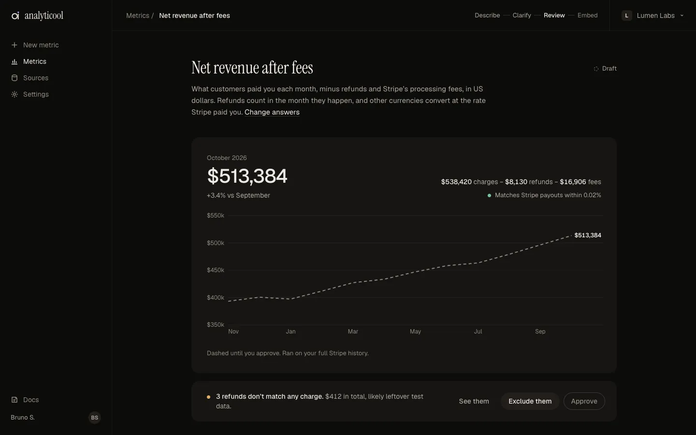
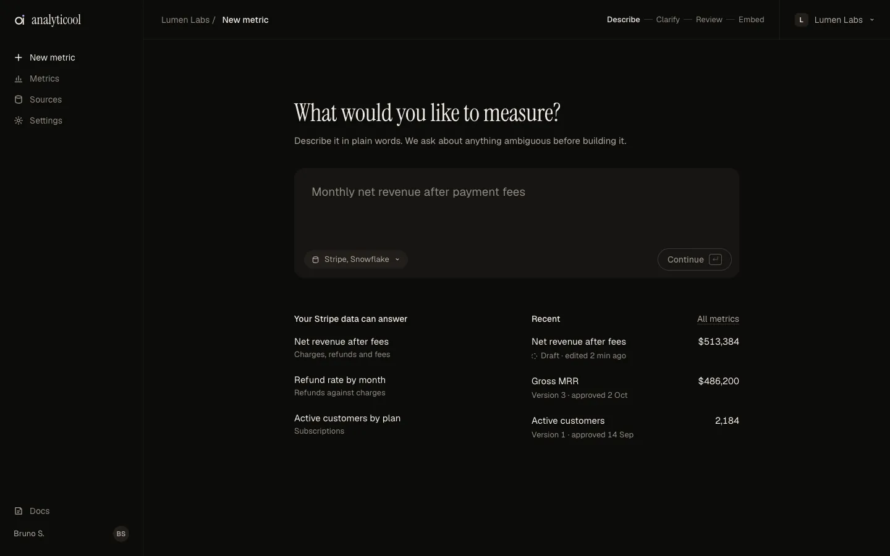
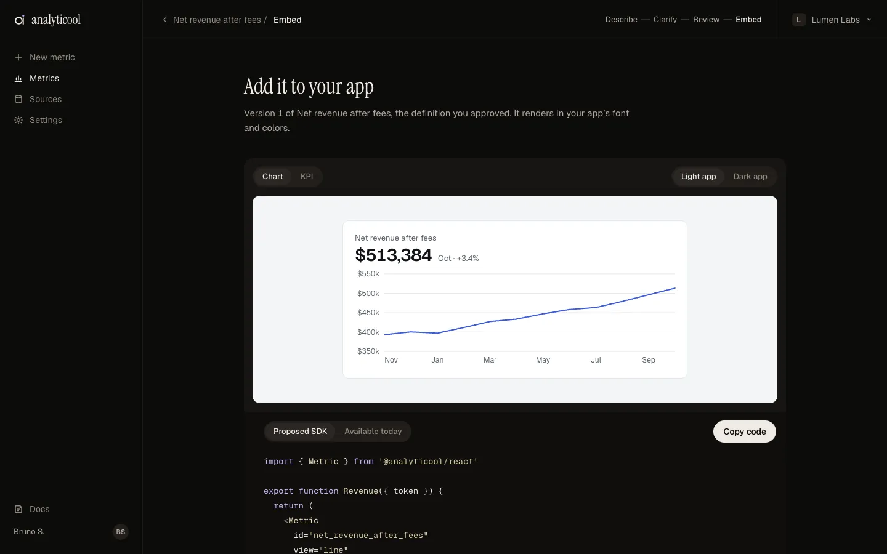
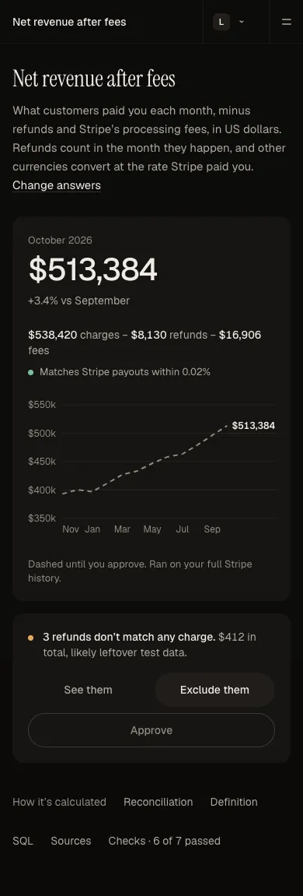

# Darkroom B+

Analyticool's approved visual direction (BRU-456): a warm dark interface with very subtle grain, one editorial display line per screen, and colour reserved for data and status. The reference is Resend's clarity: every screen answers one question first, and technical detail (SQL, sources, checks, reconciliation) stays one click away.



- [`SPEC.md`](SPEC.md): tokens, typography, layout, components, responsive rules, motion, accessibility, and what is proposed versus what exists.
- [`prototype/`](prototype/): the clickable reference (Describe → Clarify → Review → Embed). Plain HTML, CSS and JS with no dependencies.

## Run the prototype

The pages load shared scripts and icons, so serve the folder over HTTP:

```sh
node docs/design/darkroom/prototype/build.mjs   # only after editing prototype/src/*.src.html
python3 -m http.server 8766 --directory docs/design/darkroom
# open http://127.0.0.1:8766/prototype/index.html
```

Useful entry points:

- `prototype/review.html?state=error` and `?state=loading` show the error and loading states.
- `prototype/clarify.html?stay=1` keeps Clarify on screen after the last question.
- Add `?display=sans` to any page to see the direction without the serif.

Fonts (Geist, Geist Mono, Instrument Serif, all SIL OFL) load from Google Fonts; without a network the pages fall back to system faces.

## Edit it

- Page markup lives in `prototype/src/*.src.html`. Run `build.mjs` to inject the shared shell (sidebar, top bar, creation stages) and write `prototype/<page>.html`.
- `base.css` holds the palette, faces and browser surfaces; `shell.css` the shell and base components; `components.css` the B+ components and motion; `app.js` the behaviour; `data.js` the sample data (with assertions).

## Use it when building UI

1. **Treat the prototype as the visual source of truth** and `SPEC.md` as the contract: take values from the token tables, not from screenshots.
2. **Start from the screen's question.** The largest element answers it, and there is one primary action.
3. **Keep complexity behind progressive disclosure:** a plain-language answer first, with SQL, lineage, checks and reconciliation in "How it's calculated".
4. **Typography is replaceable.** Use the role tokens (`--font-display`, `--sans`, `--mono`), never a font name in a component; the serif is optional.
5. **The Embed SDK must accept the customer's CSS.** The Analyticool theme is a default (SPEC §8).
6. **Respect the Proposed labels.** The hosted `<Metric>` API, tokens, origins and natural-language metrics do not exist yet; today's code is `@analyticool/core` plus `<MetricChart result />`. Do not present the orphan-refund handling as verified logic (SPEC §10).
7. **Motion is feedback, not decoration:** follow SPEC §6, never animate data, and honour `prefers-reduced-motion`.

| Describe                               | Embed                            | Phone                                                |
| -------------------------------------- | -------------------------------- | ---------------------------------------------------- |
|  |  |  |

Third-party code and fonts: see [`THIRD_PARTY_NOTICES.md`](THIRD_PARTY_NOTICES.md).
